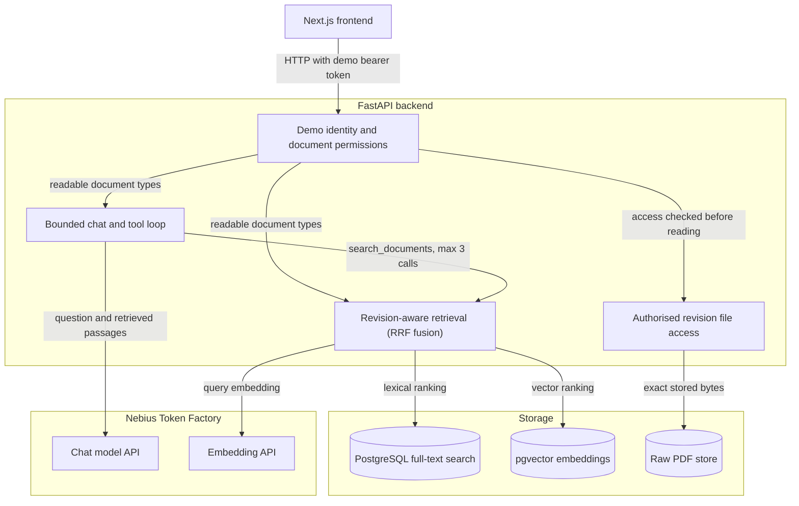

# Construction Document Assistant

[](LICENSE)


A prototype that turns construction project documents into source-linked requirements, searchable passages and cited answers, while tracking which revision is in force.

On a construction project, obligations are spread across procedures, safety rules and commercial terms, and those documents are reissued during the works. Acting on a superseded revision, or showing commercial terms to someone who should not see them, is a costly mistake.


## Key capabilities

- **Permission-aware hybrid retrieval.** PostgreSQL full-text ranking and pgvector similarity, fused with reciprocal rank fusion and scoped by the API to the documents the signed-in identity may read.
- **Bounded LLM tool calling with source references.** The chat model gets one search tool and at most three calls per question. The backend fixes project and permissions, and removes citations to passages it never retrieved.
- **Explicit supersession and historical retrieval.** A revision leaves force only when a later revision states that it supersedes it; superseded revisions stay searchable as history.
- **PDF preview with query highlighting and revision downloads.** Results open the stored PDF at the matching quote's page, and downloads return that revision's exact bytes after a permission check.
- **Source-linked requirement register.** Each requirement links to its exact quote, page and revision, with role and deadline only where the sentence states them. It is built from **authored fixture answers** replayed through the evidence gate, not from live model output.

## Architecture



The API enforces permissions on every content endpoint; the interface only reflects them. The model has no database access: it sees only passages the backend retrieved for it, and its citations are checked against them.

**Stack:** Next.js 16, React 19, TypeScript, Tailwind CSS 4 · FastAPI, Python 3.12, async SQLAlchemy, Alembic · PostgreSQL 17 with pgvector · Nebius Token Factory (OpenAI-compatible) · Docker Compose.

## Quick start

Requires Docker with Compose v2. From the repository root:

```bash
docker compose -f infra/demo/compose.yml up -d --build --wait
```

Open **http://localhost:3100**. The first start loads the fictional project at Rev A.

Stop the stack; the database and file volumes are kept:

```bash
docker compose -f infra/demo/compose.yml down
```

Offline, the register, lexical search, PDF preview, downloads, revisions and permissions all work. **Hybrid search and Ask project documents need Nebius credentials and indexed embeddings.**

<details>
<summary><strong>Optional: enable live hybrid search and chat</strong></summary>

1. Create the git-ignored root `.env` from the template, then set `NEBIUS_API_KEY` (PowerShell: `Copy-Item .env.example .env`):

   ```bash
   cp .env.example .env
   ```

   The template fills in `NEBIUS_BASE_URL`, `MODEL_FAST`, `MODEL_STRONG` and the `EMBEDDING_*` settings. Compose passes them to the API container only.

2. Restart with the env file:

   ```bash
   docker compose --env-file .env -f infra/demo/compose.yml up -d --build --wait
   ```

3. In the app, sign in and press **Load next revision (demo)** so Rev B is included in the index.

4. Embed the stored revisions, then confirm each reports `"embedded": true`:

   ```bash
   docker compose --env-file .env -f infra/demo/compose.yml exec api python -m app.demo.construction_search index-live --yes
   docker compose --env-file .env -f infra/demo/compose.yml exec api python -m app.demo.construction_search status
   ```

Indexing, hybrid queries and chat make **paid provider calls**. After **Reset local demo**, repeat steps 3 and 4.

</details>

Roles, checks and troubleshooting are in the [setup guide](docs/setup.md).

## Try it

1. **Ask about inspection notice.** *Needs live credentials and indexing.* Sign in as **Commercial Manager**, load Rev B, and open the project. In **Ask project documents**, ask *How much notice must be given before an inspection?* The answer should give 72 hours, with a source line for the Rev B PDF that opens the cited passage.
2. **Open the source PDF.** In **Search documents**, keep **Lexical** (works offline) and search *inspection notice*. The preview opens Rev B at the matching page with query words highlighted; download saves that exact revision.
3. **Compare Rev A and Rev B.** Open **Revisions**: Rev B's supersession statement is quoted, and the notice changes from 48 to 72 hours. The register keeps Rev A's requirement under **Superseded history**.
4. **Check restricted access.** Use **Switch identity** in the sidebar and sign in as **Site Engineer**. Commercial Terms disappears, searches return no commercial passage, and the API refuses the document with 403.

## Scope and limitations

- **Small synthetic corpus.** One fictional project: three documents across four PDF revisions (inspection procedure Rev A and Rev B, safety rules, commercial terms), labelled synthetic on every page.
- **Curated requirement register.** 11 hand-authored requirements replayed through the extraction gate demonstrate the evidence and revision logic; extraction accuracy is not measured.
- **Live AI covers retrieval and chat only.** Embeddings, hybrid search and the cited chat use live models; the demo's requirement extraction does not.
- **Demo identities, not authentication.** Two selectable identities without passwords demonstrate server-side, document-type permissions. Anyone who can reach the API can choose either.
- **Local prototype.** A local Docker Compose stack with small, targeted checks; no general accuracy or security claim.

## Documentation

- [Setup guide](docs/setup.md): running the demo, live configuration, roles, checks and troubleshooting.
- [Design and verification](docs/design-and-verification.md): how retrieval, supersession and chat are bounded, what was verified live and offline, and the retrieval benchmark.
- [Demo data](demo_data/README.md): the synthetic documents and authored fixtures.
- [Architecture notes](docs/architecture/) and [decision records](docs/decisions/), inherited from CourseFlow.

## Acknowledgement

This project builds on **CourseFlow**, an earlier course-document prototype, and reuses its architecture, ingestion, evidence gate and retrieval code. Some internal names are inherited: a *course* is a project and a *version* is a revision.

## License

[Mozilla Public License 2.0](LICENSE).
